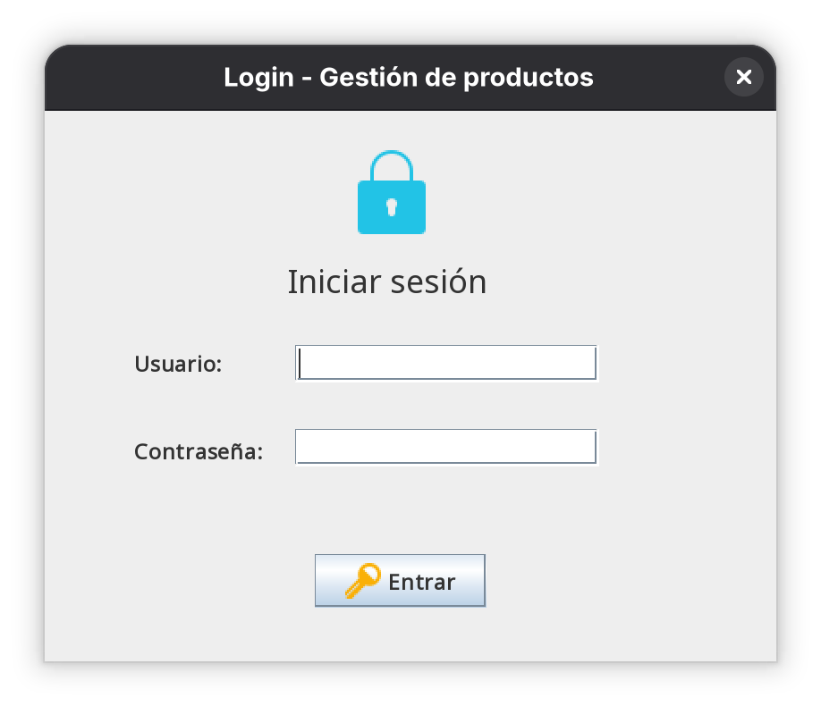

# Gestión de librería – Java Swing + MySQL

Aplicación de escritorio para gestionar el catálogo de una librería de filosofía:
productos organizados por categorías, con inicio de sesión y acceso a datos
mediante JDBC. Proyecto desarrollado durante el ciclo de Desarrollo de
Aplicaciones Web (DAW).

## Funcionalidades

- Inicio de sesión de usuarios validado contra la base de datos
- Consulta de productos (libros) filtrada por categoría
- Alta de nuevos productos asociados a una categoría

## Tecnologías

Java · Swing · MySQL / MariaDB · JDBC · NetBeans (Ant) · Javadoc

## Arquitectura

Patrón MVC con una capa de acceso a datos (DAO):

| Paquete | Contenido |
|---|---|
| `modelos/` | `Producto`, `Categoria`, `Usuario` |
| `ventanas/` | Interfaz gráfica con Swing |
| `controladores/` | Gestión de eventos y lógica de la aplicación |
| `daos/` | Acceso a la base de datos con consultas parametrizadas (`PreparedStatement`) |
| `app/` | Clase principal (`MainProyecto`) |

## Base de datos

Tres tablas relacionadas: `categorias`, `productos` (con clave foránea a
`categorias`) y `usuarios`. El script `bd_sanchez_proyecto.sql` crea la base de
datos, las tablas y unos datos de ejemplo.

## Cómo ejecutarlo

### Requisitos
- JDK 17 o superior (o el que uses en NetBeans)
- MySQL o MariaDB en `localhost:3306` (probado con MariaDB 10.4)
- NetBeans
- [MySQL Connector/J](https://dev.mysql.com/downloads/connector/j/)

### Pasos
1. Importa `bd_sanchez_proyecto.sql` en tu servidor (el propio script crea la base
   de datos `bd_sanchez_proyecto`).
2. Si tu usuario o contraseña de MySQL son distintos de `root` / vacía, cámbialos
   en `src/daos/ConexionBBDD.java`.
3. Abre el proyecto en NetBeans y añade el `.jar` de MySQL Connector/J a las
   librerías del proyecto.
4. Haz *Clean and Build* (necesario para que se carguen bien los iconos) y ejecuta
   `app.MainProyecto`.

**Usuario de prueba:** `admin` / `1234`

## Capturas

<!-- Añade 2-3 imágenes en una carpeta docs/ y enlázalas así: -->
<!--  -->

## Posibles mejoras

- Guardar las contraseñas con hash en lugar de texto plano
- Sacar la configuración de conexión a un fichero externo
- Edición y borrado de productos

## Autor

Juan Sánchez Santiago
# liberia-swing-sql
# liberia-swing-sql
